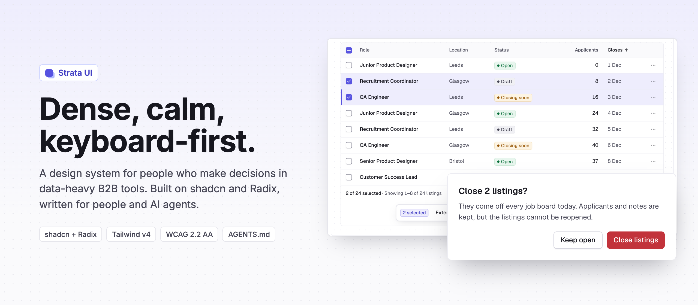

<p align="center">
  
</p>

# Engineering-First Design System for Complex Apps

TwoUX makes UX decisions explicit for engineers and AI agents, and enforces quality before inconsistent experiences reach production.

**Beta, 0.1.0.** Built on [shadcn/ui](https://ui.shadcn.com) and [Radix](https://www.radix-ui.com), for [React 19](https://react.dev) and [Tailwind CSS v4](https://tailwindcss.com).

<p>
  <a href="https://www.npmjs.com/package/@twoux/ui"></a>
  
  
  <a href="LICENSE.md"></a>
</p>

**[Quick start with your agent](#quick-start-with-your-agent)** · **[Get started](#getting-started)** · **[Connect over MCP](#connect-over-mcp)** · **[Why TwoUX](#why-twoux)** · **[Rules for agents](AGENTS.md)** · **[Every page](llms.txt)** · **[Licence](LICENSE.md)**

- **Agent Experience on both sides.** Rules your coding agent follows, and components for the people who supervise agents.
- **A knowledge base, not a component list.** 122 jobs, 46 patterns, every rule sourced.
- **Complex, never complicated.** 121 compact, keyboard-first components for dense B2B apps. WCAG 2.2 AA.
- **Guardrails over guidelines.** Lint, guard hook and a contrast-checked theme.

## Quick start with your agent

Paste this into Claude Code, Cursor, Codex or Copilot:

```text
Set up the TwoUX design system in this project. Install @twoux/ui with this repo's package manager, then run `npx twoux init` and read node_modules/@twoux/ui/agent/AGENTS.md. For every UI job, find the component with `npx twoux find "<job>"` (or the twoux MCP server's find_component tool) and read its page before writing code. Run `npx twoux check` before you finish and fix every error.
```

Then give it your brand:

```text
Give this app our brand with TwoUX. Set primary, radius and font in twoux.theme.json to match our brand, run `npx twoux theme`, and import ./twoux-theme.css after @twoux/ui/styles.css. If the generator refuses a colour for contrast, use the closest colour it accepts and tell me which.
```

## Getting started

Requires React 19 and Tailwind CSS v4.

**1. Install**

```bash
npm install @twoux/ui
# or
pnpm add @twoux/ui
# or
yarn add @twoux/ui
```

**2. Set up your agents**

```bash
npx twoux init
```

This adds the TwoUX rules to `AGENTS.md` and `CLAUDE.md`, connects the MCP server, and adds the TwoUX skills, a guard hook and `twoux.theme.json`. It never overwrites a file; it adds to what is there.

**3. Import the styles and use a component**

```tsx
import '@twoux/ui/styles.css';
import { Button, Toaster, toast } from '@twoux/ui';

export function App() {
  return (
    <>
      <Button shortcut="C" onClick={() => toast.success('Listing created')}>
        New listing
      </Button>
      <Toaster />
    </>
  );
}
```

**4. Check before you merge**

```bash
npx twoux check
```

## Connect over MCP

`npx twoux init` connects it for you. To add it by hand:

| Tool        | Command or file                                                                                                             |
| ----------- | --------------------------------------------------------------------------------------------------------------------------- |
| Claude Code | `claude mcp add twoux -- npx -y @twoux/ui mcp`                                                                              |
| Codex       | `codex mcp add twoux -- npx -y @twoux/ui mcp`                                                                               |
| Cursor      | `.cursor/mcp.json`: `{ "mcpServers": { "twoux": { "command": "npx", "args": ["-y", "@twoux/ui", "mcp"] } } }`               |
| VS Code     | `.vscode/mcp.json`: `{ "servers": { "twoux": { "type": "stdio", "command": "npx", "args": ["-y", "@twoux/ui", "mcp"] } } }` |

The server runs on your machine and reads only the installed package. Its tools: `find_component`, `get_doc`, `list_docs`, `get_rules` and `check`.

## The twoux command

| Command                  | What it does                                                                      |
| ------------------------ | --------------------------------------------------------------------------------- |
| `npx twoux init`         | Sets up the project for AI agents. `--principles` for an app not built with TwoUX |
| `npx twoux find "<job>"` | Names the component or pattern for a job, how to use it and what not to use       |
| `npx twoux docs [id]`    | Lists every page, or prints one. `docs rules` prints every rule                   |
| `npx twoux check`        | Lints app code against TwoUX's rules. Exits 1 on errors                           |
| `npx twoux theme`        | Builds `twoux-theme.css` from `twoux.theme.json`, checking contrast               |
| `npx twoux mcp`          | Runs the MCP server                                                               |

## Packages

| Package                    | Description                                                                     |
| -------------------------- | ------------------------------------------------------------------------------- |
| [`@twoux/ui`](packages/ui) | Components, tokens, styles, agent files, the `twoux` command and the MCP server |
| [`twoux`](packages/twoux)  | Runs `npx twoux` with the `@twoux/ui` installed in your project                 |

## Why TwoUX

### Building got faster and cheaper. So did inconsistency.

Building and shipping UI has never been faster or cheaper. Consistency didn't come with it. AI doesn't fix the mess, it scales it. Engineers build through coding agents, often with no designer in the loop and no Figma file to check against. But design systems ship components, not decisions. A button doesn't say when not to use it. So the agent picks the nearest piece and fills every gap with a guess.

Each guess looks fine on its own: a modal for record detail, a disabled submit, an error in a toast, a delete with no Undo. Together they turn one product into five. That debt shows up later as duplicated components, accessibility fixes and screens that each behave differently.

|        |                                                                               |
| ------ | ----------------------------------------------------------------------------- |
| **13** | engineers per designer in AI-company job postings¹                            |
| **4×** | more cloned code since AI coding assistants²                                  |
| **0**  | rules on when not to use a dialog in the docs of popular component libraries³ |

<sub>¹ Applied Methods, analysis of 9,281 open roles at AI companies, 2026. ² GitClear, AI Copilot Code Quality 2025: 211M changed lines, 2020 to 2024. ³ Dialog pages of shadcn/ui and Radix, checked November 2026: API and examples, no guidance on when to use or avoid it.</sub>

The design systems out there weren't built for this. Most give you components, often basic ones, and stop there:

- **No Agent Experience.** Written for people browsing docs, not for an AI agent that needs rules it can read and follow.
- **Not built for complex B2B.** Buttons and cards, but not the dense tables, spreadsheet grids, dashboards and AI interfaces B2B products run on.
- **No logic, no UX.** What a component looks like, but not which job it's for, how the flow behaves, or when to confirm and when to offer Undo.
- **No guardrails.** Nothing stops an agent from inventing a grey, rebuilding a dropdown or shipping AI slop.

### Nobody needs more components

Engineers and product teams don't need more components. They need what the best UX designers and the design systems of market-leading products already know, written down where every agent can read it and every check can enforce it.

TwoUX is a research-backed knowledge base built on UX expertise. It decides the UX, not only the look: which component fits which job, how a flow behaves, when to confirm and when to offer Undo. None of it is an LLM's opinion. Every decision is grounded in published usability research, WCAG, WAI-ARIA and the design systems of major SaaS products, and every component page explains its decisions with numbered sources.

- **Agent Experience (AX), on both sides.** AX means designing for AI agents as users, the way UX designs for people. TwoUX does it twice. The coding agent that builds the UI gets rules it can read and follow: `AGENTS.md`, `llms.txt`, a Markdown page per component and skills to build, audit and propose. The people who supervise agents inside the product get components for plans, approvals, run timelines and permissions, so they stay in control.
- **A knowledge base, not a component list.** 122 jobs, each mapped to one component, with what to use instead, plus 46 patterns that walk through whole flows step by step. Every rule carries its reason and its numbered sources.
- **Complex, never complicated.** Not another generic dashboard UI kit: 121 components for dense tables, spreadsheet grids, charts and AI agent interfaces, compact and keyboard-first, in light and dark, with the right interactions, states and motion built in, so the correct choice is also the good-looking one. WCAG 2.2 AA.
- **Guardrails over guidelines.** A lint for raw values and local copies, a Claude Code hook that blocks edits to the system, and a browser audit for contrast, focus and spacing. A theme file that refuses colours that fail WCAG.

## Tested on real agents

Claude Opus, Sonnet and Haiku, given realistic developer requests in a TwoUX project and never told the rules, November 2026:

| Result       | What it means                                                               |
| ------------ | --------------------------------------------------------------------------- |
| **0 of 14**  | runs changed the design system without being asked                          |
| **10 of 10** | planted UX problems found by every model, including the 4 no linter can see |
| **3 of 3**   | rebrands went through the theme file, not page-by-page overrides            |

The four problems only the rules caught are the judgement calls a designer makes: a modal for record detail, a disabled submit, an error in a toast and a delete without Undo. When a developer insisted on editing a component directly, two of three models did, and `twoux check` caught both. Every failure became a new check.

## Built by a UX engineer, for engineers and their agents

TwoUX stands on the shoulders of the brilliant minds behind every source it cites. I started from a decade of UX decisions I kept explaining in reviews, and the mistakes I kept fixing in agent-written UI, then researched how standards and mature SaaS design systems solve each one. Each answer became a rule, a job or a pattern step, with its source (611 links, all checked).

Components are generated from shadcn's untouched source by a script, so the API stays familiar to engineers and agents. The docs site and the agent files come from the same content, so people and agents get the same answer.

Giulia Pizzignacco, founder and UX engineer

## Project structure

| Directory         | Purpose                                                             |
| ----------------- | ------------------------------------------------------------------- |
| `apps/docs`       | The docs site, with live examples and example apps                  |
| `apps/playground` | A sandbox app built only from TwoUX                                 |
| `packages/ui`     | The `@twoux/ui` package                                             |
| `packages/twoux`  | The `twoux` command package                                         |
| `docs-md/`        | One Markdown page per foundation, component and pattern, for agents |
| `scripts/`        | Generators for the agent files, theme, palette and checks           |

## Contributing

Issues and pull requests are welcome. By sending one, you agree to the contribution terms in section 8 of the licence.

```bash
corepack enable
pnpm install
pnpm dev        # docs site on http://localhost:3100
pnpm verify     # type check, interaction, responsive and design checks
```

To report a security problem, follow [SECURITY.md](SECURITY.md).

## Licence

Free to use under the [TwoUX Licence](LICENSE.md): build and ship any number of your own products with it, including commercial products and client work. Don't sell or republish TwoUX, or a modified copy, as a design system, UI kit, template or component library, and don't train models on it. Third-party notices are in [NOTICE.md](NOTICE.md).
